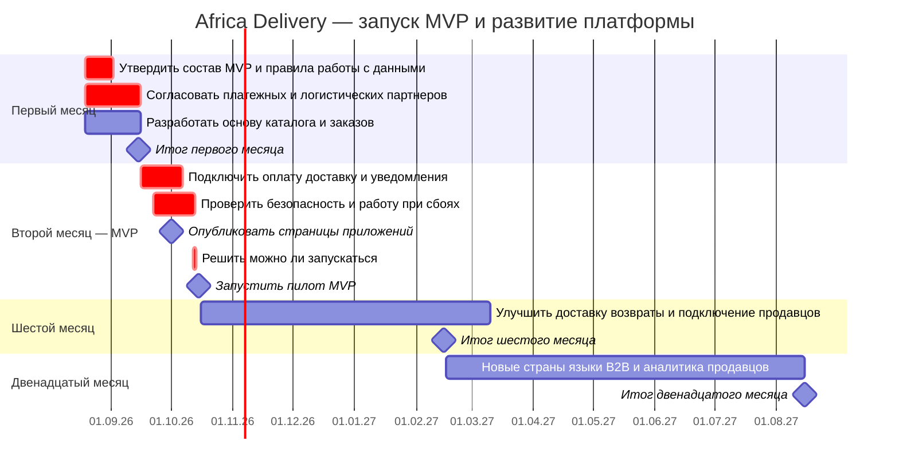

# Дорожная карта

**Период планирования:** август 2026 — август 2027 года. 

**Дата запуска MVP:** 15 октября 2026 года.

**Что показывает документ:** какие возможности появятся в каждом периоде, кто за них отвечает, сколько стоит инфраструктура и что нужно проверить перед следующим этапом.

## Как определены функции для MVP

В MVP включаем только то, что позволяет покупателю пройти основной путь: **посмотреть товар → оформить заказ → оплатить → передать заказ на доставку → получить сообщение о статусе**.

Также обязательны меры, без которых нельзя безопасно принимать деньги, сохранять заказы и соблюдать закон. Цель первого запуска — **5000 товаров (SKU) от 100 продавцов в Нигерии и Кении**.

Если предлагается добавить новую функцию до запуска, CEO должен согласовать, какую задачу равной трудоёмкости команда уберёт из плана. Это защищает срок 15 октября от постоянного расширения работ.

Источники — описание кейса, артефакты 1, 4, 6, `fmea.md`.

## Результат обработки списка из 29 функций

Полностью в исходном объёме не вошла ни одна из 29 функций. Четыре функции вошли в упрощённом виде. Остальные 25 отложены. 

| Решение | Пункты артефакта 4 | Что получит покупатель или бизнес |
| --- | --- | --- |
| **Частично включены, 4 пункта** | **1, 11, 26, 28** | **1** — каталог из 5000 товаров без дополнительных сложных вариантов.   **11** — оплата через M-Pesa и Flutterwave.   **26** — простой инструмент загрузки и проверки товаров.   **28** — основные показатели продаж для CEO без непрерывного обновления отчёта. |
| **Отложены, 25 пунктов** | **2–10, 12–25, 27, 29** | Умный и голосовой поиск, рекомендации, прямые эфиры, чаты, отзывы, сложная регистрация продавцов, расширенный кабинет, кредитование, электронный кошелёк, токены и игровые механики, специальные акции, автоматическое изменение цен, отслеживание доставки в реальном времени, видео на пунктах выдачи, быстрые возвраты, автоматическая защита от мошенничества, B2B, реферальная программа, USSD, полный набор одинаковых функций во всех трёх клиентах, публичный GraphQL API и тёмная тема. |

Источники — артефакты 1, 2, 4.

## График работ (Mermaid Gantt)

## Результат каждого этапа

| Этап | Что должно быть готово | Кто выполняет | Расходы на инфраструктуру | Когда можно переходить дальше |
| --- | --- | --- | --- | --- |
| **Первый месяц — 15.09.2026** | Согласованный список функций MVP, основа каталога и оформления заказов, модель данных и правила подключения внешних сервисов | 6 контракторов, CTO и архитектор | **$3 792/мес** по предварительной модели. Стоимость отдельных страновых контуров нужно уточнить | Согласованы правовые условия и доступ к платёжным и логистическим партнёрам. Если нет — неподтверждённые сценарии нельзя включать в запуск |
| **Второй месяц, MVP — 15.10.2026** | Пилот в Нигерии и Кении. 5000 товаров от 100 продавцов. Заказ и оплата через M-Pesa и Flutterwave. Уведомления, простой кабинет покупателя и отчёт для CEO | 6 контракторов. Дополнительный наём до декабря запрещён | Лимит **$5 000/мес**. План **$3 792/мес**, запас по модели **$1 208/мес** | Проверены настоящие платежи, передача заказов в доставку, законность обработки данных и работа при сбоях |
| **Шестой месяц — 15.02.2027** | Улучшено подключение продавцов. Развиваются возвраты и информация о доставке. Подготовка выхода в ЮАР при наличии юридического разрешения | До декабря — 6 контракторов. Состав после декабря не утверждён | Бюджет не согласован. Нужен новый расчёт стоимости | Есть подтверждённый спрос, условия работы партнёров и финансирование |
| **Двенадцатый месяц — 15.08.2027** | Цель — работа в пяти странах, более 1 млн пользователей, продажи бизнес-клиентам (B2B), аналитика для продавцов, новые языки и контроль выдачи заказов | Состав команды нужно определить по нагрузке и бюджету | Расчёт для пяти стран отсутствует, требуется отдельное финансирование | Подтверждены правовые условия новых стран, выдержана ожидаемая нагрузка и доказана экономическая целесообразность |

Перед запуском 15 октября руководство должно принять решение **Go/No-Go** — разрешить запуск или остановить его до устранения критических проблем. Если не подтверждены безопасность платежей, законность обработки данных или возможность доставки, запуск платных заказов недопустим.

Источники — артефакты 1–3, 6, `open-questions.md`, `fmea.md`.

## Кто входит в команду

Для разработки предусмотрено **6 контракторов**. Ниже — предлагаемые роли. Один специалист может помогать в соседних задачах, но у каждой области должен быть основной ответственный.

| Роль | Главная задача | Дополнительно помогает |
| --- | --- | --- |
| **1. Ведущий backend-разработчик** | Оформление заказов и правильное хранение статусов платежей | Разбор критических ошибок заказа и оплаты |
| **2. Backend-разработчик** | Каталог товаров и данные продавцов | Передача заказов в службы доставки |
| **3. Разработчик интеграций** | Подключение платёжных систем, служб доставки и уведомлений | Сверка операций с партнёрами |
| **4. Разработчик мобильного приложения** | Приложение покупателя с экономным расходом мобильного интернета | Проверка работы при слабой связи |
| **5. Инженер тестирования (QA)** | Проверка оформления заказов, оплаты и поведения при сбоях | Автоматические проверки перед выпуском изменений |
| **6. Инженер эксплуатации (DevOps/SRE)** | Развёртывание приложения, база данных, мониторинг и восстановление после сбоев | Организация дежурств |

### Офис в Найроби или удалённая работа

**Рекомендуется распределённая команда.** При ограниченном бюджете постоянный офис в Найроби не обязателен для разработки. Команда работает в общих репозиториях кода, выпускает изменения через автоматизированный процесс (CI/CD) и каждый день имеет общее время для обсуждений.

### Как обеспечить дежурство 24/7

Предлагаемый порядок:
1. Мониторинг автоматически проверяет каталог, заказы и платежи в любое время суток.
2. На каждую неделю назначаются **основной дежурный** и **резервный**, с учётом часовых поясов команды.
3. Если проблема связана с оплатой, подключаются ведущий backend-разработчик и CTO. При серьёзном региональном отказе — CTO и CEO.
4. Для дежурных готовятся короткие инструкции по восстановлению системы, доступы к мониторингу и согласованные сроки реакции.
5. Работа вне обычного времени и оплата вызовов должны быть прямо предусмотрены договорами.

**Ограничение:** шесть человек не обеспечивают полноценную круглосуточную поддержку автоматически. Пока неизвестны их часовые пояса, рабочие часы и условия контрактов, такой график нельзя считать гарантированным. Требуется утвердить реальное расписание с резервом на отпуск и болезнь.

Источники — артефакт 6, `observability.md`, `failover-plan.md`.

## Допущения
1. Контрольные даты первого, шестого и двенадцатого месяцев предложены для планирования. Инвестор прямо закрепил только дату запуска 15 октября 2026 года.
2. Указанное распределение ролей — предложение. Навыки, доступность и часовые пояса шести контракторов пока не подтверждены.
3. Для загрузки каталога предполагается простой внутренний инструмент. Он не заменяет полную проверку продавца (KYC) и не доказывает рекламное обещание о проверенных продавцах.
4. Дежурства вводятся только после согласования условий контрактов и фактического покрытия всех часов суток.
5. Выход в пять стран и расширение функциональности потребуют отдельно согласованных людей и бюджета. Нельзя считать, что для этого хватит тех же шести контракторов.
