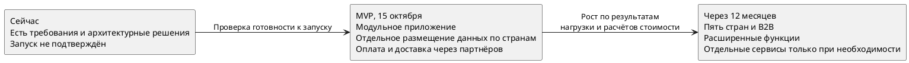

# Переходная архитектура Africa Delivery

## Как будет развиваться платформа

Платформа создаётся с нуля. К 15 октября 2026 года нужен работающий MVP для Нигерии и Кении. В течение следующих 12 месяцев бизнес планирует выйти в пять стран и добавить новые способы работы с продавцами и доставкой. Для этого не нужно сразу строить сложную систему из десятков сервисов. Важно с первого дня разделить части приложения по ответственности, чтобы в дальнейшем менять их по отдельности.

| Область | Сейчас | MVP, 15 октября 2026 года | Через 12 месяцев | Источник |
| --- | --- | --- | --- | --- |
| Возможности для бизнеса | Есть требования и предложения, готовый продукт не подтверждён | Покупатель выбирает товар, оформляет и оплачивает заказ. Доставка организуется через партнёров | Работа с B2B-клиентами, возвраты, расширенные возможности доставки и кабинет продавца | Описание кейса, арт. 4, ADR № 1 |
| Устройство платформы | CTO предложил сложную микросервисную архитектуру | Одно приложение, разделённое на независимые по логике модули | Модули сохраняются. Отдельные сервисы появляются только там, где это оправдано нагрузкой и расходами | `options-comparison.md`, ADR № 1 |
| Оплата | Договоры с провайдерами не подтверждены | Подключение M-Pesa и Flutterwave, проверка результата каждого платежа | Подключение провайдеров новых стран, при необходимости Paystack | Арт. 3, 6, FMEA F-03 |
| Доставка | Собственного логистического решения нет | Передача заказов в Sendbox и Sendy, контроль заявок, которые не удалось передать | Отслеживание доставки, возвраты и развитие пунктов выдачи, если подтверждена экономика | Описание кейса, арт. 5, FMEA F-05 |
| Данные | Рабочие системы и места хранения не подтверждены | Отдельное размещение и обработка персональных данных для Нигерии и Кении | Отдельные контуры для новых стран. Общая аналитика использует только разрешённые обезличенные данные | Арт. 3, ADR № 3 |
| Надёжность | Требования определены, проверки не проведены | Мониторинг, резервное копирование, проверка восстановления и защиты платежей. Доступность 99,9% пока проектная цель | Повторная оценка доступности 99,99% и более сложных сценариев восстановления с учётом стоимости | `availability-strategy.md`, NFR, FMEA |
| Инфраструктура | Предложение CTO превышает бюджет | Минимальная инфраструктура с автоматизированным выпуском обновлений и контролем сбоев | Увеличение мощностей и разделение компонентов по результатам измерений | Арт. 5, 6, ADR № 1, CN check-list |

## Как перейти к целевой архитектуре без переписывания

1. **Разделить приложение на модули с понятными обязанностями.** Каталог, заказы, платежи, доставка, покупатели и уведомления могут работать в одном приложении. При этом каждый модуль отвечает за свои правила и данные, а остальные обращаются к нему через предусмотренные интерфейсы. Источник — ADR № 1, CN.LCP.05.
2. **Подключать партнёров через отдельные интеграционные компоненты.** При смене платёжного или логистического партнёра потребуется изменить его подключение, а не весь процесс покупки. Такой же подход позволит добавлять новые страны. Источник — ADR № 1, ADR № 3, FMEA F-03, F-05.
3. **Сразу определить, кто отвечает за данные.** Для MVP допустима одна база данных в каждой стране, если таблицы разделены по модулям. В дальнейшем нужную часть данных можно перенести в отдельный сервис постепенно, с проверкой результатов. Источник — ADR № 3, теория спринта 8 «Переходная архитектура».
4. **Сохранять состояние незавершённых операций.** При задержке ответа от платёжного или логистического партнёра платформа должна помнить, что уже было сделано. Повторный запрос не должен создавать вторую оплату или заказ. Это позволит впоследствии менять способ фоновой обработки без изменения действий покупателя. Источник — FMEA F-03, F-04, F-05, F-08, QAS-04.
5. **Усложнять архитектуру только при доказанной необходимости.** Основанием для выделения сервиса станут реальные проблемы со скоростью работы, нагрузкой или стоимостью. Перед изменением CTO должен оценить пользу и новый TCO. Источник — `observability.md`, NFR, ADR № 1.

## Схема перехода

## Что обязательно проверить перед запуском

До начала платных операций необходимо подтвердить договоры с платёжными и логистическими партнёрами, законность обработки данных в обеих странах и работоспособность полного сценария покупки. Также нужны испытания восстановления после сбоев и защиты от повторного списания денег.

Нулевую потерю подтверждённых платежей нельзя гарантировать только резервным копированием. Потребуются проверка сохранения операций и сверка их статусов с провайдерами. Источники — артефакты 3 и 6, FMEA F-02, F-03, `failover-plan.md`.

## Допущения
1. Структура данных и правила обмена между компонентами пока проектные. Перед изменениями потребуется проверить их совместимость.
2. Выход в пять стран за 12 месяцев — цель бизнеса. Готовность инфраструктуры, бюджет и юридические условия для этого пока не подтверждены.
